<h1 align="center">Hey  I'm Soumay</h1>

<h3 align="center">Backend Engineer · Systems Thinker · Builder</h3>

  I build things that scale, tools that developers love, and AI that actually does something useful.

  <code>Java</code> · <code>Spring Boot</code> · <code>TypeScript</code> · <code>Go</code> · <code>Kubernetes</code> · <code>AI / MCP</code>

---

- ⚙️ Backend systems, and the observability tools around them.
- 🧠 Distributed systems, infrastructure, and AI agents.
- 🛠️ I like understanding how things work under the hood.
- 📚 Currently exploring:
   
  

<b>🧰 toolbox</b> — click to open

 

**Languages & backend**

 
 

**Infra & DevOps**

 
 

**Databases & observability**

 
 

**Protocols & tools**

 

 

---

### 📂 Projects

- [mail-intelligence-platform](https://github.com/soumaydutt/mail-intelligence-platform) — MailGuard: checks if an email address looks deliverable without ever touching the mailbox — format validation plus DNS/MX routing checks, with full validation history and a dashboard · `Java` `TypeScript` `JavaScript`
- [indianlingo](https://github.com/soumaydutt/indianlingo) — building a Duolingo-style app for Indian languages: gamified lessons, starting English → Hindi, designed to scale to all major Indian languages · `TypeScript` `CSS`
- [excalibur-web-access](https://github.com/soumaydutt/projects/tree/main/excalibur-web-access) — full-stack billing and customer-care platform for telecom/ISP providers: customer 360, invoicing, payments, collections and role-based access, on .NET 8 + React · `C#` `TypeScript`
- [smart-pill-dispenser-app](https://github.com/soumaydutt/projects/tree/main/smart-pill-dispenser-app) — medication companion for patients and caregivers: next-dose dashboard, adherence tracking and dose history, built with Expo + React Native · `TypeScript`
- [ExplainableChess-main](https://github.com/soumaydutt/projects/tree/main/ExplainableChess-main) — teaches a small language model to explain chess like a human coach: Stockfish-labelled positions fine-tuned into GPT-2, so it says why a move works, not just what to play · `Python`

---

### 💻 Languages

Across all my public repos (forks excluded, by code bytes):

`TypeScript 44.6%` · `Java 33.9%` · `C# 11.7%` · `JavaScript 6.5%` · `Python 1.3%` · `PLpgSQL 0.7%` · `HTML 0.5%` · `Go 0.4%` · `CSS 0.3%` · `Dockerfile 0.1%` · `Shell 0.0%`

---

### 🏙️ Contribution city

  

---

  <a href="mailto:soumaydutt019@gmail.com">Gmail</a> ·
  <a href="https://www.linkedin.com/in/soumay-dutt-1851a73a5">LinkedIn</a>

  <i>Less hype. More shipped code. 🚀</i>

